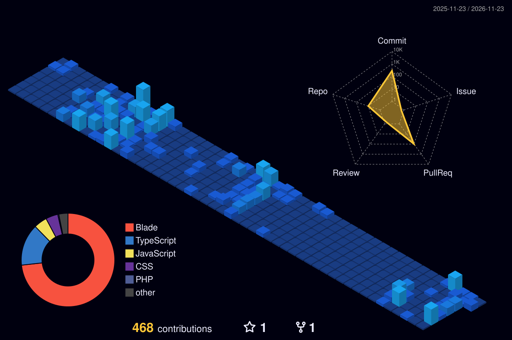
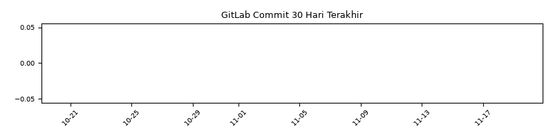

<!-- 🎬 HERO — Captain's Log Pose Viewfinder -->

  

<!-- 🏴‍☠️ MY PIRATE WAY — Monster Trio Architecture -->

  

<!-- ⚔️ HAKI & SANTORYU ARSENAL — Tech Stack -->

  

<!-- 🪪 GRAND LINE FLEET ID + PRODUCTION DASHBOARD -->

  

## 🏴‍☠️ S-Rank Voyages & Production Systems

<table>
<tr><th>Voyage / System</th><th>What it is</th><th>Haki &amp; Arsenal Used</th><th align="center">Impact / Scale</th></tr>
<tr>
  <td><a href="https://porto-web.zeondev.site"><b>Customer-PPJK — Logistics, Customs &amp; Financial Portal</b></a> PT Tako Anugerah Koporasi (2026)</td>
  <td>Paperless export-import &amp; PPJK customs portal unifying trucking dispatch, Indonesia's Customs API (<b>CEISA</b>) declarations, billing &amp; live shipment tracking, backed by automated PHPUnit/JS test suites.</td>
  <td><code>PHP 8</code> <code>Laravel</code> <code>JavaScript</code> <code>Docker</code> <code>PostHog</code></td>
  <td align="center"><b>84 Events</b> CEISA Live</td>
</tr>
<tr>
  <td><a href="https://porto-web.zeondev.site"><b>Crypto Trading &amp; Signal Execution System</b></a> Automated Quant Pipeline (2025 – 2026)</td>
  <td>Live 1-year algorithmic trading platform unifying <b>Binance &amp; Bybit</b> wallets under a single TradingView dashboard for BTC/ETH; paired Python QuantConnect scripts (technical + social-sentiment APIs) with Telegram order execution.</td>
  <td><code>Python</code> <code>QuantConnect</code> <code>Laravel</code> <code>TradingView</code> <code>Telegram API</code></td>
  <td align="center"><b>24/7 Live</b> BTC / ETH</td>
</tr>
<tr>
  <td><a href="https://porto-web.zeondev.site"><b>Kaikei — Multi-Tenant POS &amp; Accounting SaaS</b></a> MSME Cloud &amp; Offline-First SaaS (2026)</td>
  <td>Affordable POS, inventory &amp; cashflow SaaS built from scratch after interviewing local MSME owners (~80% shared stock/cashflow bottlenecks); engineered offline <b>IndexedDB</b> sync queues and 3-database yearly partitioning.</td>
  <td><code>Next.js</code> <code>React</code> <code>TypeScript</code> <code>Laravel</code> <code>Dexie.js</code></td>
  <td align="center"><b>3-DB Sync</b> Offline-First</td>
</tr>
<tr>
  <td><a href="https://porto-web.zeondev.site"><b>Enterprise ERP, CRM, Queue &amp; Employee Systems</b></a> PT Imagine Space Tech (2024 – 2025)</td>
  <td>Developed &amp; maintained core production platforms across <b>20+ client projects</b>; completed <b>345+ medium-to-high complexity engineering tasks</b> &amp; SQL query optimizations.</td>
  <td><code>Laravel</code> <code>PHP 8</code> <code>MySQL</code> <code>PostgreSQL</code> <code>REST API</code></td>
  <td align="center"><b>50+ Orgs</b> 345+ Tasks</td>
</tr>
<tr>
  <td><a href="https://github.com/zeondev19"><b>Batik Pattern Defect Computer Vision Inspector</b></a> Gemastik 2023 National Finalist</td>
  <td>Camera-based computer vision inspection tool detecting batik pattern defects, color deviations, and size accuracy — <b>Top 21 of 335 Teams Nationally</b> (+ Kemendikbud PKM Grant Team Leader for UAV Fixed-Wing Drone reforestation).</td>
  <td><code>Python</code> <code>Computer Vision</code> <code>OpenCV</code> <code>AI Inspection</code></td>
  <td align="center"><b>Top 21</b> National</td>
</tr>
<tr>
  <td><a href="https://github.com/zeondev19/Capstone_Project_C624-PS056"><b>Catering Web Management Platform</b></a> Full-Stack Capstone Project</td>
  <td>End-to-end online catering management system with dynamic menu personalization, real-time order tracking, and automated invoicing.</td>
  <td><code>Laravel</code> <code>Vue.js</code> <code>TailwindCSS</code> <code>MySQL</code></td>
  <td align="center">⚓ Public Repo</td>
</tr>
</table>

<a href="https://github.com/zeondev19?tab=repositories"><b>→ Explore all 24+ public repositories on GitHub</b></a> &nbsp;·&nbsp; <a href="https://gitlab.com/zeondev19"><b>GitLab Personal</b></a> &nbsp;·&nbsp; <a href="https://porto-web.zeondev.site"><b>porto-web.zeondev.site</b></a>

  

### 🌃 My Grand Line Contribution City

*Every commit across GitHub &amp; synced GitLab pipelines raises another tower — rebuilt automatically every day.*

 

<b>📊 View Synced GitLab Enterprise &amp; Multi-Platform Commit Graph</b>

 

<i>My daily production commits are actively split across <b>GitHub</b>, <b>GitLab Personal</b>, and <b>PT Tako Anugerah Koporasi's Enterprise Pipelines</b>:</i>

  

<!-- 💌 JOIN THE GRAND FLEET -->

  

  

  

**Kaizoku Ou ni, Ore wa Naru! — Code is a game, and I engineer to win.** ⚡🏴‍☠️

